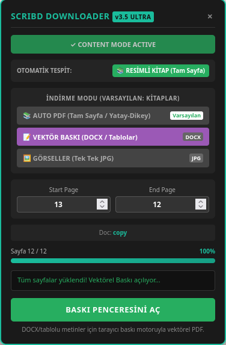

<div align="center">
  
# 📚 Scribd-Downloader-js

### 🚀 Download any document from Scribd as crisp PDF or Images — 100% Free!

<br/>

[](https://github.com/AllLiveSupport/Scribd-Downloader-js/stargazers)
[](LICENSE)
[](scribd.user.js)

<br/>


---

**✨ Smart Engine • 🎯 Auto Book vs DOCX Detection • 📐 Full-Bleed Landscape/Portrait PDF • 🚀 Zero A4 Margin Clipping**

<br/><br/>



</div>

<br/>

---

## ⚡ What's New in v3.5 ULTRA?

- 📚 **Kitaplar Modu Varsayılan (Tam Sayfa / Orijinal Boyut)**: Her sayfa kendi orijinal boyutunda ve yönünde (kapak yatay, sayfalar dikey) A4 sınırı veya kenar boşluğu olmadan sıfır kayıpla direkt indirilir.
- 🧠 **Hatasız Belge Tespiti**: KPSS, taranmış kitaplar, romanlar ve sunumlar 1px kırpma sınırlarına takılmadan anında `📚 RESİMLİ KİTAP (Tam Sayfa)` olarak tanınır.
- 📝 **İsteğe Bağlı Vektör Baskı**: Yalnızca gerçek Word/DOCX ve vektörel tablolu metinler için kullanıcı istediğinde tek tıkla `VEKTÖR BASKI` seçilebilir.
- 📐 **Dinamik Yatay/Dikey Eşleme**: Yatay kapaklar ve dikey sayfalar PDF içerisinde tam sayfa yerleşir, beyaz kenarlık bırakmaz.
- 🔤 **Otomatik Dosya Adı**: İndirilen PDF veya baskı penceresi gerçek kitap adını alır (`document.title` kilitlenmesi).

---

## 🎯 Three Methods

| Method | Best For | Difficulty | Engine |
|:-------|:---------|:-----------|:-------|
| 🌐 **Tampermonkey** | Automatic launcher button, easiest (Recommended) | ⭐ Easy | **v3.0 ULTRA** (Hybrid) |
| 💻 **Console** | Developers, one-off use via F12 | ⭐⭐ Medium | **v3.0 ULTRA** (Hybrid) |
| 🔖 **Bookmarklet** | Quick execution without extensions | ⭐ Easy | **v3.0 ULTRA** (Hybrid) |

---

<br/>

## 🌐 Method 1: Tampermonkey (Recommended)

### Step 1: Install Tampermonkey Extension

| Browser | Install Link |
|:-------:|:------------:|
|  | [Install](https://chrome.google.com/webstore/detail/tampermonkey/dhdgffkkebhmkfjojejmpbldmpobfkfo) |
|  | [Install](https://addons.mozilla.org/en-US/firefox/addon/tampermonkey/) |
|  | [Install](https://microsoftedge.microsoft.com/addons/detail/tampermonkey/iikmkjmpaadaobahmlepeloendndfphd) |

### Step 2: Install the Script

1. Open [**`scribd.user.js`**](scribd.user.js) in this repository.
2. Click the **"Raw"** button.
3. Tampermonkey will automatically detect the script and prompt to install. Click **"Install"**.

### Step 3: Usage

1. 🌐 Navigate to any document on Scribd.
2. 📥 Click the floating green **"Download"** button at the bottom-right.
3. ⚡ If prompted, switch to **Content Mode** for the best unblurred resolution.
4. ⚙️ Select **📄 PDF** or **🖼️ IMAGES** mode.
5. 🚀 Click **"START DOWNLOAD"**. Keep the PiP window open to allow seamless background processing!

<br/>

---

## 🔖 Method 2: Bookmarklet

1. **Create Bookmark**: Add a new bookmark to your browser bookmark bar.
2. **Name**: Set it to `Scribd Downloader`.
3. **URL**: Copy and paste everything from [**`Scribd Downloader Bookmark.txt`**](Scribd%20Downloader%20Bookmark.txt).
4. **Action**: Click the bookmark while viewing any Scribd document to launch the downloader panel.

<br/>

---

## 💻 Method 3: Console

1. **F12**: Open Developer Tools (`F12` or `Ctrl + Shift + I`) and switch to the **Console** tab.
2. **Paste**: Copy all code from [**`Scribd Downloader.txt`**](Scribd%20Downloader.txt).
3. **Enter**: Paste and press `Enter` to display the panel.

<br/>

---

## 🛠️ Features Detailed

- 📄 **PDF Mode**: Combines all captured high-resolution pages into a single, clean PDF file with custom page dimensions.
- 🖼️ **Image Mode**: Saves individual high-quality `.jpg` pages.
- 🧠 **Hybrid Engine**: Direct fast-path for image-only books; 2x High-DPI DOM Canvas snapshot for DOCX, Word, tables, and formula sheets.
- 📱 **PiP Background Survival**: PiP canvas video stream keeps the browser tab active when navigating to other tabs or windows.
- 🔓 **No Paywall Barrier**: Works on all embeddable Scribd content.

<br/>

---

## 📂 Project Structure

```bash
📦 Scribd-Downloader-js
 ┣ 📂 docs/images
 ┃ ┣ 🖼️ Downloader.png
 ┃ ┗ 🖼️ PIP.PNG
 ┣ 📜 LICENSE
 ┣ 📜 README.md
 ┣ 📜 scribd.user.js                 # Tampermonkey Userscript (v3.5 ULTRA)
 ┣ 📜 Scribd Downloader.txt          # Developer Console Script (v3.5 ULTRA)
 ┗ 📜 Scribd Downloader Bookmark.txt  # Bookmarklet Script (v3.5 ULTRA)
```

<br/>

---

## ⚠️ Disclaimer

> [!CAUTION]
> **Legal Notice:** This tool is provided for **personal, research, and educational backup purposes only**.
> - Respect copyright laws and original authors.
> - You are responsible for your own actions and adherence to Scribd's Terms of Service.

---

<div align="center">

### ⭐ Star this repo if it helped you!

<br/>

[](https://github.com/AllLiveSupport)

</div>
